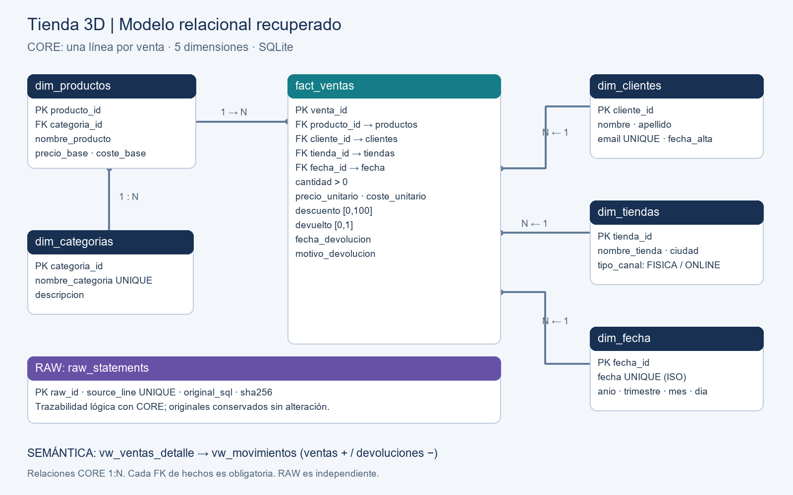

# Proyecto SQL recuperado — Tienda de impresión 3D

**Repositorio público de entrega:** [Bases-de-datos-y-SQL](https://github.com/Vlichy/Bases-de-datos-y-SQL) · Rama `main`.

Entrega SQLite auditada el 1 de noviembre de 2026. Recupera el caso existente en `Curso/Proyecto SQL`; no sustituye su historia ni convierte sus datos sintéticos en datos reales. Los originales se conservan sin cambios en `originales/`, con hashes en `reports/originales_sha256.json`.

## Ejecución rápida

Python 3.10+ con SQLite 3.37+ (por tablas STRICT). Solo biblioteca estándar: no se necesita requirements.txt ni instalar paquetes. Se ha ejecutado realmente con las versiones que constan en `reports/PRUEBAS.md`.

Desde esta carpeta:

```powershell
python run.py
python run.py --verify
```

Ubicación definitiva: `C:\Users\panio\Documents\Curso\DataScience\Bbdd SQL`.

Abrir esta carpeta en VS Code o hacer doble clic en `Bbdd SQL.code-workspace`. Las tareas **SQL: construir y comprobar** y **SQL: verificar desde cero** están preparadas en `.vscode/tasks.json`. No se necesita un entorno de Machine Learning. En Windows, si el alias `python` no funciona:

```powershell
Set-Location 'C:\Users\panio\Documents\Curso\DataScience\Bbdd SQL'
powershell -NoProfile -ExecutionPolicy Bypass -File .\run.ps1
powershell -NoProfile -ExecutionPolicy Bypass -File .\run.ps1 -Verify
```

`run.ps1` localiza una instalación Python compatible en PATH o en las carpetas habituales del usuario. Fuera de Windows se ejecuta `python run.py` y `python run.py --verify`. El ZIP se extrae en cualquier ubicación y se ejecuta igual; no requiere la carpeta anterior, Git, el CSV de Online Retail ni una conexión de red.

El primer comando crea o reconstruye exclusivamente CORE en `tienda.sqlite`, preservando RAW. Una segunda ejecución conserva exactamente las mismas filas y claves. Es una reconstrucción de una entrega estática, no una carga incremental: cualquier edición manual de CORE será reemplazada; usar una copia para experimentar. Cada transformación se ejecuta en una transacción; ante error se revierte. `--verify` crea una base SQLite vacía en memoria, reconstruye todo, ejecuta pruebas negativas y repite la carga; no modifica la base entregada. Actualiza los informes con los resultados de la última ejecución. RAW rechaza cambios del contenido de una línea ya importada.

En DBeaver puede abrirse `tienda.sqlite` y ejecutarse `03_eda.sql` completo. Activar `PRAGMA foreign_keys=ON` en cada conexión: es una opción de conexión de SQLite, no persistente en el archivo. Para crear desde cero es necesario `run.py`: importa las sentencias RAW, ejecuta `01_schema.sql` y `02_data.sql`, verifica y genera resultados. `02_data.sql` es transformación SQLite ejecutable, no un pseudocódigo de importación CSV.

## Origen, alcance y decisión

Se localizaron cinco archivos PostgreSQL de una tienda 3D: esquema, carga sintética, análisis, creación de base y README. Se migran esos datos, manteniendo categorías y relaciones existentes. La fuente de verdad es `originales/02_carga.sql`, no las cifras narradas en el README previo. Los INSERT describen 35 líneas de venta, 12 clientes, 10 productos, 5 categorías, 3 tiendas y 227 días de calendario. Las ventas abarcan enero–agosto de 2026; agosto solo hasta el día 14 en ventas, mientras el calendario llega al 15. No se infiere un mes completo.

También se examinó el proyecto Python Online Retail II y se contó su CSV accesible: 535.186 filas, 133.581 sin cliente. Su limpieza conserva cancelaciones, cantidades negativas y precios cero; elimina duplicados exactos, descripciones nulas y precios negativos. El conteo y hash real están en `reports/evidencia_datos.json`. No se utiliza como fuente del SQL porque la fase 2 pide recuperar el proyecto existente. Se evita mezclar esa fuente con la simulación. Por tanto, no se inventan países, identificadores de factura ni cancelaciones que el caso 3D no contiene.

## Cuatro capas y granularidad

| Capa | Objeto | Una fila representa |
|---|---|---|
| RAW | originales/*.sql y raw_statements | Un archivo original, o una sentencia INSERT original con número de línea, tabla destino y SHA256 |
| CORE | fact_ventas | Una línea de venta original, identificada por venta_id; no una factura |
| CORE | dim_clientes | Un cliente sintético registrado |
| CORE | dim_productos | Un producto del catálogo sintético |
| CORE | dim_categorias | Una categoría comercial presente en la fuente |
| CORE | dim_tiendas | Una tienda o canal de venta |
| CORE | dim_fecha | Un día del calendario cargado |
| Semántica | vw_ventas_detalle | Una línea enriquecida con dimensiones e importe tras descuento |
| Semántica | vw_movimientos | Una venta positiva o una devolución negativa fechada en su fecha de devolución |
| Analítica | 03_eda.sql, reports/analisis.md | Diez preguntas de negocio con SQL, resultados y lectura empresarial |



## Modelo y normalización

La estructura recuperada es una estrella con categoría separada del producto, formando una pequeña extensión en copo de nieve. Los atributos del cliente, tienda y calendario no se repiten en hechos. La categoría depende del producto y tiene su propia tabla, por lo que se evita repetir su descripción en el catálogo. El precio, coste y descuento de cada operación se guardan en hechos para preservar las condiciones históricas, aunque cambie el precio base. El calendario almacena atributos derivados como desnormalización deliberada para enseñar agrupaciones; se validan contra la fecha. Las cinco dimensiones y la tabla de hechos tienen PRIMARY KEY; las FK evitan huérfanos. RAW tiene su propia PK y número de línea UNIQUE.

NOT NULL, UNIQUE, CHECK y DEFAULT constan en el esquema y se prueban con inserciones o actualizaciones válidas e inválidas. STRICT impide que texto arbitrario se convierta silenciosamente en cero en columnas numéricas. Las fechas ISO se validan con `date(...,'+0 days')`; los triggers de INSERT y UPDATE rechazan devoluciones anteriores a su venta. Los índices de fecha, producto, cliente y tienda facilitan filtros, JOIN y agrupaciones; el índice de categoría ayuda a navegar producto–categoría. Por el pequeño volumen, no se afirma una mejora de rendimiento medida.

## Ventas, devoluciones y dinero

En esta fuente una devolución está codificada por `devuelto=1` en la línea original; no por cantidad negativa. El CORE conserva cantidades positivas. `vw_movimientos` genera el movimiento negativo al devolver, sin confundirlo con un error. Se asume devolución completa al importe tras descuento; no hay datos de devoluciones parciales, gastos de devolución ni reembolso efectivo. **Ingreso neto modelado = ventas tras descuento − líneas devueltas**, bajo esa hipótesis. La devolución se imputa a su fecha real. No es beneficio ni facturación fiscal comprobada.

Se utiliza REAL de SQLite por compatibilidad con los precios originales; se redondea cada línea a dos decimales antes de agregar. Los resultados son educativos, no una contabilidad exacta. En producción se usarían enteros en céntimos y reglas explícitas de redondeo. La función Python `importe_venta` utiliza Decimal y ROUND_HALF_UP y está implementada y probada en `run.py`. SQLite no permite CREATE FUNCTION almacenada en SQL; `create_function` registra una función escalar en cada conexión Python. Puede probarse con `SELECT importe_venta(2,12.9,10)` en una conexión creada por `connect`; devuelve 23,22. No estará disponible automáticamente en DBeaver. Las consultas entregadas no dependen de ella.

## Calidad, trazabilidad y limitaciones

`04_quality_checks.sql` y la sección inicial de `03_eda.sql` comprueban nulos, duplicados potenciales, fechas, tipos, rangos, claves, coherencia de devoluciones y RAW/CORE. La validación automática añade comparación de todos los valores de las seis tablas contra una carga independiente de los INSERT originales, normalizando solo cadenas NULL de email y ciudad. No se eliminan duplicados por semejanza ni se rellenan ciudades sin evidencia. Un canal online sin ciudad es legítimo; un email ausente tampoco invalida una venta.

**Investigación cerrada con advertencia de origen:** las trece ventas anteriores al alta ya aparecen en los INSERT originales; no son un error de migración. La fuente no impone alta≤venta ni define si alta es primera relación comercial o registro de cuenta posterior. Por ello no se ha demostrado que todas sean errores de negocio ni puede atribuirse la causa a un generador concreto. Se conservan las fechas y se identifica el riesgo para análisis de antigüedad/captación. Detalle de las trece líneas, desfases y evidencia en `reports/INVESTIGACION_FECHAS.md`. Su aclaración definitiva requiere al autor de la fuente; no bloquea los análisis económicos presentados.

No hay identificador de factura, clientes desconocidos en hechos ni código de cancelación. No puede calcularse ticket por factura, recurrencia de pedidos, ingreso por país ni tasa de cancelación. Q10 informa repetición de líneas, expresamente distinta de repetición de pedidos. La fuente no permite separar devoluciones de cancelaciones si el autor original las hubiera mezclado: se respeta únicamente la bandera explícita. No se simulan observaciones inexistentes. Los costes no demuestran beneficio neto porque no contienen logística, impuestos ni costes fijos.

## Análisis y evidencia

Las diez consultas principales están numeradas en `03_eda.sql`. Los controles y ejemplos DML son secciones técnicas, no preguntas de negocio adicionales. Cada consulta incluye pregunta, SQL, técnica y referencia al resultado; `reports/analisis.md` reproduce el SQL y todas las filas del resultado, junto a su interpretación. `queries.json` permite ejecutar esas consultas y se verifica que sus resultados coinciden con los del archivo principal.

Tres conclusiones calculadas: Figuras lidera con 340,11 EUR netos; Granada Centro concentra 727,64 EUR, el 61,76 % del neto; cuatro líneas devueltas suponen el 11,43 % de líneas y 200,40 EUR de reembolso modelado, el 14,54 % de la venta tras descuento. Son observaciones del caso sintético, no conclusiones generalizables al comercio real.

## Entregables

- `AUDITORIA_INICIAL.md`, `reports/inventario.json`: auditoría antes de transformar e inventario accesible.
- `01_schema.sql`, `02_data.sql`, `03_eda.sql`, `04_quality_checks.sql`: esquema, transformación, análisis principal y controles.
- `run.py`, `queries.json`, `tienda.sqlite`: construcción, ejecución y base entregada.
- `model.png`, `model.mmd`: diagrama y fuente textual editable.
- `reports/PRUEBAS.md`, `reports/pruebas.json`, `reports/analisis.md`, `reports/resultados.json`: resultados reales y evidencia automática.
- `MATRIZ_CUMPLIMIENTO.md`, `CAMBIOS.md`, `PRESENTACION.md`, `GITHUB.md`: contraste de requisitos, cambios, defensa de seis minutos y estado Git.

## Repositorio

Repositorio independiente de Machine Learning, publicado por autorización del usuario en [Vlichy/Bases-de-datos-y-SQL](https://github.com/Vlichy/Bases-de-datos-y-SQL), rama `main`. `GITHUB.md` detalla la evidencia y los pasos para integrar. `.gitignore` conserva expresamente `tienda.sqlite` y excluye archivos auxiliares, ZIP/RAR, entornos y cachés; el código y las fuentes sintéticas permiten reconstruirlo. No se incluyen credenciales ni datos de clientes reales de Online Retail. Los nombres y emails presentes son los del escenario sintético declarado por el autor original.

## Conciliación económica y entrega final

La vista `vw_ventas_detalle` separa `importe_antes_descuento`, `importe_descuento` e `importe_venta`. El campo `importe_bruto` es un alias histórico de **importe_venta tras descuento**, mantenido para no romper las diez consultas; no debe interpretarse como venta a tarifa. `vw_movimientos` resta devoluciones completas al importe efectivamente modelado de la venta. `reports/CONCILIACION_ECONOMICA.md` detalla bruto a tarifa − descuentos = ventas tras descuento; ventas − devoluciones = ingreso neto. Se contrasta con cálculos independientes Decimal.

El ZIP `entrega_sql_tienda_3d.zip` está dentro de esta carpeta y contiene fuentes, originales, base y evidencias. Excluye el propio ZIP, `.git` y cachés. `reports/ZIP_VERIFICACION.json` registra la extracción y ejecución independiente desde una base inexistente. La copia previa en MachineLearning queda conservada como respaldo histórico y no interviene en la ejecución definitiva. No se crea otra subcarpeta de proyecto dentro de esta raíz.

La presentación empieza mostrando el modelo dimensional y selecciona únicamente Q2 (categorías), Q4 (canales) y Q5 (devoluciones). Se mantienen las diez consultas principales. El guion aplica las recomendaciones de Javier de la sesión del 18 de junio **según las indicaciones facilitadas por el usuario**; no se dispone de una grabación o transcripción para contrastar otras recomendaciones.

### Corrección verificada de dos céntimos

La conciliación independiente detectó que las líneas 6 (54,90 con 5 %) y 30 (24,90 con 5 %) se calculaban como 52,15 y 23,65 por coma flotante. Se aplica redondeo HALF_UP por línea: 52,16 y 23,66. Las vistas convierten precios a céntimos y descuentos a puntos básicos y usan división entera antes de expresar euros. Precios y fechas RAW/CORE no cambian. Las pruebas comprueban la precisión de entrada y ambos casos de regresión. Todos los resultados analíticos se han regenerado; el neto aumenta dos céntimos. Los tipos REAL se conservan en la fuente, pero el cálculo de venta evita la coma flotante intermedia para los datos de dos decimales verificados.
